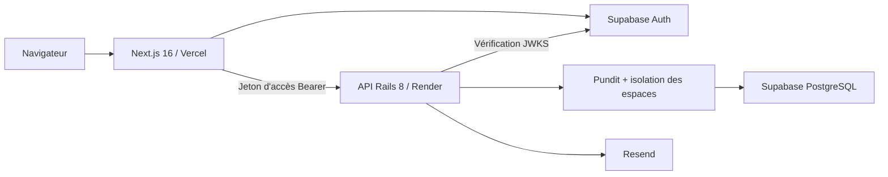

# SignalDesk

SignalDesk est un espace d'intelligence dédié aux retours clients, conçu pour
les équipes produit, support et direction. Il transforme des retours dispersés
en un Signal Feed partagé, dans lequel les équipes peuvent qualifier les
informations, définir les priorités, discuter des décisions et boucler la boucle.

[Ouvrir le produit en ligne](https://signal-desk-lake.vercel.app) | [Lire l'architecture](docs/architecture.md) | [Consulter les compromis techniques](docs/technical-tradeoffs.md)


## Périmètre fonctionnel

- Une landing page publique orientée conversion, avec un header adapté à l'état d'authentification.
- Une authentification Supabase par email et mot de passe, avec des sessions SSR sécurisées.
- Un parcours de création d'espace de travail avec les rôles propriétaire, administrateur et membre.
- Une Control Room alimentée par les données réelles de l'espace de travail.
- Un cycle de vie complet des Signals : création, consultation, modification, priorisation et résolution.
- Une recherche, des filtres, un tri, des tags, des clients et un état du feed partageable par URL.
- Des commentaires et une chronologie d'activité immuable pour faciliter la collaboration.
- Des invitations aux espaces de travail envoyées avec Resend, révocables et limitées dans le temps.
- Un formulaire public configurable avec CORS, honeypot et limitation du nombre de requêtes.
- Des états de chargement, d'attente, de réussite, d'erreur et de liste vide cohérents avec la marque.
- Une navigation au clavier, une gestion de la réduction des animations, un affichage responsive et une couverture Axe automatisée.

## Architecture

SignalDesk est un monorepo composé de deux applications déployées indépendamment.
Next.js gère le rendu et les interactions ; Rails gère les données métier,
l'autorisation et les règles du domaine. Supabase fournit l'authentification et
l'infrastructure PostgreSQL, mais le navigateur n'interroge jamais directement
les tables métier.



Le flux complet des requêtes, les frontières de confiance et la topologie de
déploiement sont détaillés dans
[`docs/architecture.md`](docs/architecture.md).

## Visite du produit

### Control Room

La vue d'ensemble de l'espace réunit le volume actif, la pression des priorités,
les boucles clôturées et les derniers Signals dans une seule vue opérationnelle.


### Signal Feed

Les équipes peuvent rechercher, filtrer, trier et partager l'état du feed sans
perdre le contexte apporté par les clients, les tags, la source, le statut et la
priorité.


### Détail d'un Signal

La vue détaillée rassemble la qualification, les échanges et l'historique
d'audit afin qu'une décision reste compréhensible une fois la réunion terminée.


### Collecte publique

Chaque espace de travail peut publier un formulaire ciblé qui crée un Signal
sans exposer le produit authentifié ni les données des autres espaces.


## Technologies

| Couche | Technologie | Responsabilité |
| --- | --- | --- |
| Web | Next.js 16, React 19, TypeScript, Tailwind CSS 4 | SSR, navigation, formulaires et retours d'interaction |
| Animations | GSAP | Animations maîtrisées sur la landing page avec prise en charge de la réduction des mouvements |
| API | Rails 8.1, Ruby 3.4, Puma | Logique métier, validation, sérialisation et endpoints API |
| Données | PostgreSQL sur Supabase | Données métier relationnelles et contraintes de base de données |
| Identité | Supabase Auth | Identifiants, sessions, jetons d'accès ES256 et JWKS |
| Autorisation | Pundit | Contrôle des accès par rôle et par espace de travail |
| Email | Action Mailer et Resend | Envoi des invitations aux espaces de travail |
| Qualité | RSpec, Playwright, Axe, RuboCop, Brakeman, ESLint | Comportement, accessibilité, style et contrôles de sécurité |
| Déploiement | GitHub Actions, Vercel, Render | CI et déploiement indépendant du frontend et de l'API |

## Structure du dépôt

```text
apps/
  api/                 API JSON Rails
  web/                 Application Next.js avec App Router
docs/                  Documentation technique ciblée
scripts/               Utilitaires d'orchestration locale
supabase/              Configuration locale de Supabase
tests/e2e/             Parcours navigateur et tests de non-régression d'accessibilité
PLAN_SIGNALDESK.md     Feuille de route produit et état d'avancement
DESIGN_SYSTEM.md       Spécification visuelle et interactive complète
DESIGN_CONTEXT.md      Contexte de design synthétique pour l'implémentation
```

## Installation locale

Prérequis : Homebrew, Colima et Docker. Les versions des outils du projet sont
verrouillées dans [`mise.toml`](mise.toml).

```bash
brew install mise colima docker
mise install
pnpm install
```

Démarrer le moteur de conteneurs, Supabase et la base de données :

```bash
colima start --cpu 2 --memory 4 --disk 20
pnpm supabase:start
pnpm db:prepare
```

Lancer Next.js et Rails ensemble :

```bash
pnpm dev
```

| Service | URL locale |
| --- | --- |
| Next.js | http://localhost:3000 |
| Santé de Rails | http://localhost:3001/up |
| Santé de l'API versionnée | http://localhost:3001/api/v1/health |

Les variables d'environnement et leurs responsabilités sont documentées dans
[`/.env.example`](.env.example). Supabase affiche en local les clés publiques
utilisées par les applications web et API.

## Espace de démonstration

Créer un espace de présentation complet avec un compte local confirmé :

```bash
pnpm demo:seed
```

La commande affiche les identifiants de connexion et l'URL du formulaire
public. Elle est idempotente, refuse les hôtes Supabase non locaux et reconstruit
uniquement l'espace qui lui est réservé. Le jeu de données comprend 18 Signals
réalistes couvrant tous les statuts, priorités et sources, ainsi que 10 clients,
sept tags, huit membres, des commentaires et un historique d'activité.

Le contrat de données et les garanties de sécurité sont détaillés dans
[`docs/demo-data.md`](docs/demo-data.md).

Pour régénérer les captures du portfolio à partir de ce jeu de données
déterministe, avec les applications locales en cours d'exécution :

```bash
pnpm portfolio:capture
```

## Vérification

Lancer les contrôles locaux rapides, équivalents à ceux de la CI :

```bash
pnpm check
```

Lancer la validation complète avant mise en production, avec le parcours réel
dans le navigateur et les analyses Axe :

```bash
pnpm test:e2e:install
pnpm check:release
```

La suite Rails couvre les modèles métier, l'autorisation, l'isolation des espaces,
les invitations, les protections du formulaire public et les services de
collaboration transactionnels. La suite Playwright crée une identité temporaire
dans Supabase local, se connecte, initialise un espace de travail, publie un
Signal puis supprime ses données de test.

Pour aller plus loin : [`docs/end-to-end-testing.md`](docs/end-to-end-testing.md)
et [`docs/accessibility-audit.md`](docs/accessibility-audit.md).

## Modèle de sécurité

1. Supabase gère les identifiants et définit les cookies de session SSR.
2. Next.js vérifie la session avant d'afficher les routes protégées.
3. Next.js transmet à Rails le jeton d'accès de courte durée sous forme de jeton Bearer.
4. Rails vérifie la signature ES256 avec le JWKS de Supabase et synchronise uniquement l'identité minimale de l'utilisateur.
5. Pundit limite chaque ressource à son espace et applique les rôles propriétaire, administrateur et membre.
6. Les contraintes PostgreSQL garantissent l'intégrité entre les enregistrements. Les tables métier utilisent RLS sans politiques d'accès direct depuis le navigateur, car Rails constitue l'unique chemin d'accès aux données.

Les soumissions publiques anonymes appliquent des limites strictes aux champs,
un honeypot, un CORS limité aux origines autorisées et une limitation des
requêtes par adresse IP et par espace. Les jetons d'invitation sont stockés sous
forme d'empreintes SHA-256 plutôt qu'en clair.

## Production

| Composant | Fournisseur | URL |
| --- | --- | --- |
| Web | Vercel | https://signal-desk-lake.vercel.app |
| API | Render | https://signal-desk-api-5jsn.onrender.com |
| Authentification et PostgreSQL | Supabase | Infrastructure privée du projet |
| Emails transactionnels | Resend | Adaptateur d'envoi pour Action Mailer |

Vercel déploie `apps/web` comme répertoire racine. Render construit l'image
Docker Rails depuis `apps/api` avec [`render.yaml`](render.yaml). Les deux
applications sont déployées depuis `main`, tandis que les GitHub Actions filtrées
par chemin n'exécutent les jobs web et API que lorsque le code ou les dépendances
concernées changent.

## Direction artistique

SignalDesk applique volontairement un langage visuel radical et pop à un outil
B2B rigoureux, sans transformer le produit en œuvre interactive. La typographie
dense, les bordures franches, les aplats de couleur et les animations précises
portent son identité. La navigation prévisible, les états lisibles et les
contrôles familiers préservent son efficacité au quotidien.

[`DESIGN_SYSTEM.md`](DESIGN_SYSTEM.md) constitue la source de vérité complète.
Les agents et contributeurs commencent par [`AGENTS.md`](AGENTS.md), qui oriente
chaque tâche vers le contexte de design le plus pertinent et le plus concis.

## Décisions techniques

Le projet privilégie volontairement un nombre limité de services : Supabase,
Resend, Vercel et Render. Il n'ajoute ni Redis, ni plateforme de jobs, ni outil
d'analytics, ni CAPTCHA, ni second client de base de données tant que la charge
du produit ne le justifie pas.

Les bénéfices et les limites de ces choix sont documentés avec transparence dans
[`docs/technical-tradeoffs.md`](docs/technical-tradeoffs.md).
