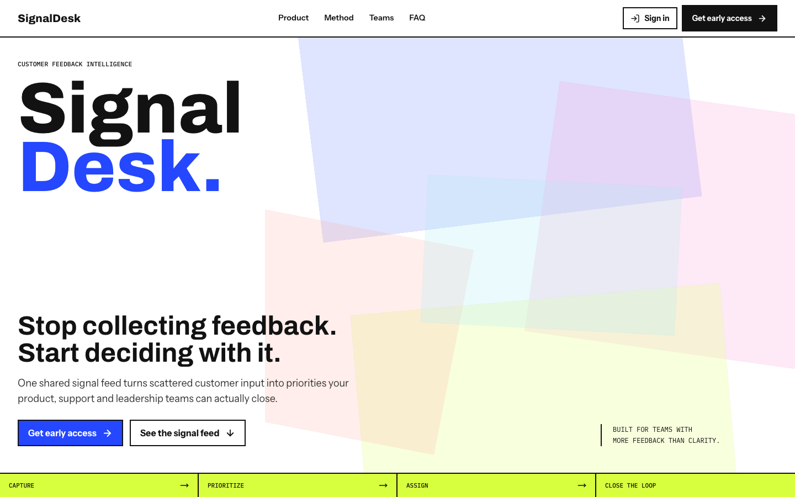
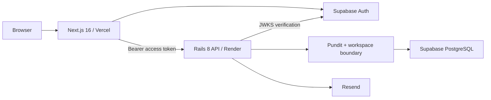
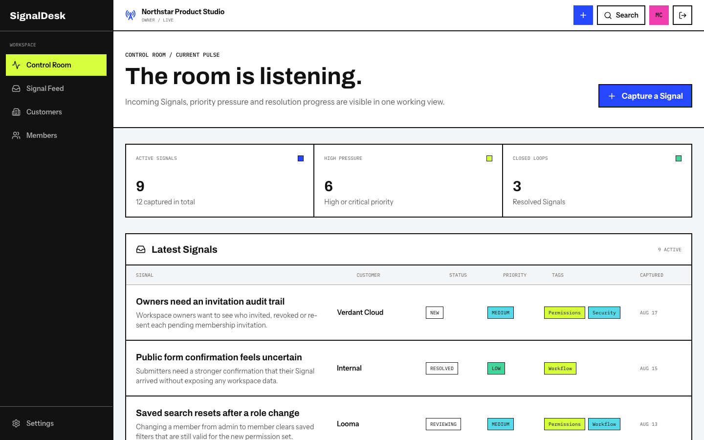
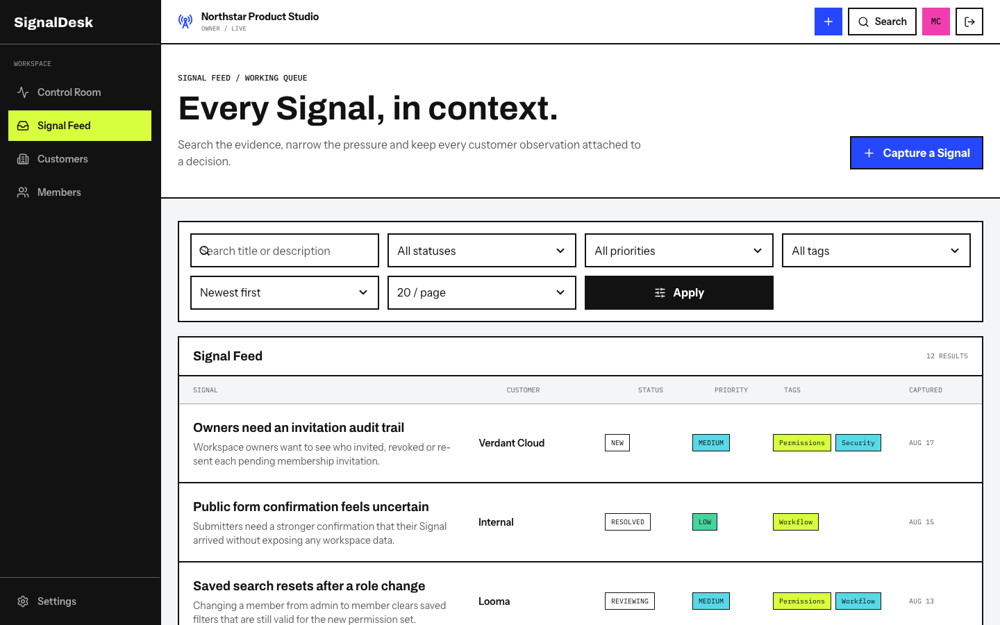
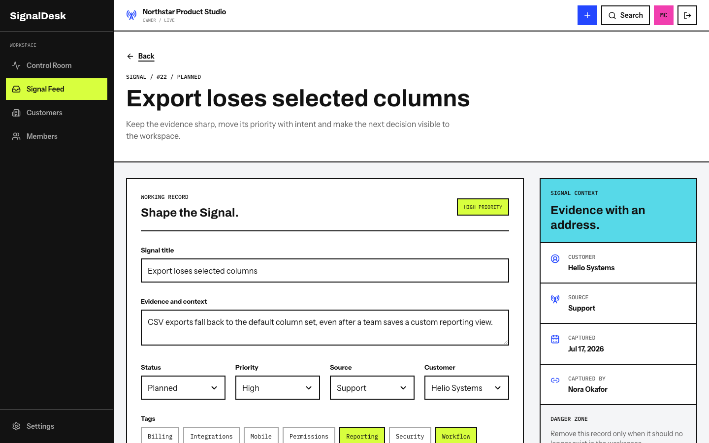
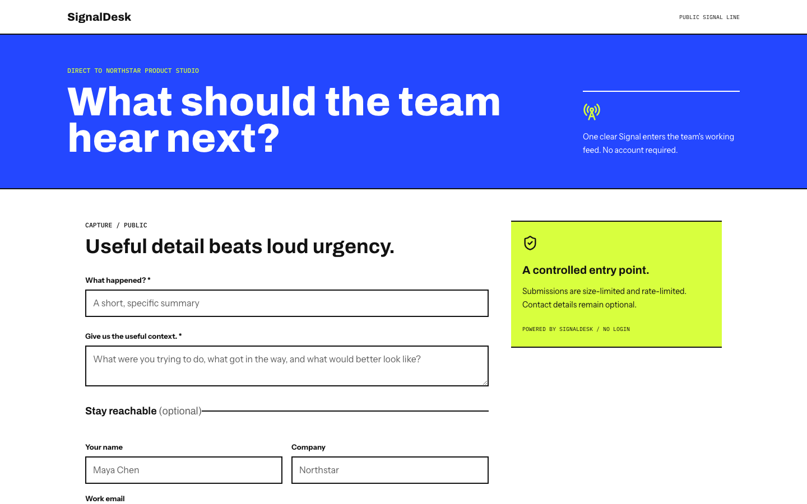

# SignalDesk

SignalDesk is a customer-feedback intelligence workspace built for product,
support and leadership teams. It turns scattered input into one shared Signal
Feed where teams can qualify evidence, set priorities, discuss decisions and
close the loop.

[Open the live product](https://signal-desk-lake.vercel.app) | [Read the architecture](docs/architecture.md) | [Review the tradeoffs](docs/technical-tradeoffs.md)



## Product scope

- A public conversion landing page with an authenticated header state.
- Supabase email/password authentication and secure SSR sessions.
- Workspace onboarding with owner, admin and member permissions.
- A Control Room based on real workspace data.
- Full Signal lifecycle: create, inspect, edit, prioritize and resolve.
- Search, filters, sorting, tags, customers and URL-shareable feed state.
- Comments and an immutable activity timeline for collaboration.
- Resend-backed workspace invitations with expiry and revocation.
- A configurable public Signal form with CORS, honeypot and rate limits.
- Branded loading, pending, success, error and empty states across the product.
- Keyboard, reduced-motion, responsive reflow and automated Axe coverage.

## Architecture

SignalDesk is a monorepo with two independently deployed applications. Next.js
owns rendering and interaction; Rails owns business data, authorization and
domain rules. Supabase provides authentication and the PostgreSQL infrastructure,
but the browser never queries business tables directly.



The complete request flow, trust boundaries and deployment topology are in
[`docs/architecture.md`](docs/architecture.md).

## Product tour

### Control Room

The workspace pulse combines active volume, priority pressure and closed loops
with the latest Signals in one operational view.



### Signal Feed

Teams can search, filter, sort and share feed state without losing the context
carried by customers, tags, source, status and priority.



### Signal detail

The detail view keeps qualification, discussion and audit history together so a
decision remains understandable after the meeting ends.



### Public capture

Each workspace can publish a focused intake form that creates a Signal without
exposing the authenticated product or tenant data.



## Technology

| Layer | Technology | Responsibility |
| --- | --- | --- |
| Web | Next.js 16, React 19, TypeScript, Tailwind CSS 4 | SSR, navigation, forms and interaction feedback |
| Motion | GSAP | Restrained landing-page motion with reduced-motion support |
| API | Rails 8.1, Ruby 3.4, Puma | Domain logic, validation, serialization and API endpoints |
| Data | PostgreSQL on Supabase | Relational business data and database constraints |
| Identity | Supabase Auth | Credentials, sessions, ES256 access tokens and JWKS |
| Authorization | Pundit | Role and workspace-level access control |
| Email | Action Mailer and Resend | Workspace invitation delivery |
| Quality | RSpec, Playwright, Axe, RuboCop, Brakeman, ESLint | Behavior, accessibility, style and security checks |
| Delivery | GitHub Actions, Vercel, Render | CI and independent frontend/API deployment |

## Repository

```text
apps/
  api/                 Rails JSON API
  web/                 Next.js App Router application
docs/                  Focused engineering documentation
scripts/               Local orchestration utilities
supabase/              Local Supabase configuration
tests/e2e/             Browser journeys and accessibility regressions
PLAN_SIGNALDESK.md     Product roadmap and completion state
DESIGN_SYSTEM.md       Full visual and interaction specification
DESIGN_CONTEXT.md      Compact design context for implementation work
```

## Local setup

Prerequisites: Homebrew, Colima and Docker. Project runtimes are pinned by
[`mise.toml`](mise.toml).

```bash
brew install mise colima docker
mise install
pnpm install
```

Start the container runtime, Supabase and the database:

```bash
colima start --cpu 2 --memory 4 --disk 20
pnpm supabase:start
pnpm db:prepare
```

Run Next.js and Rails together:

```bash
pnpm dev
```

| Service | Local URL |
| --- | --- |
| Next.js | http://localhost:3000 |
| Rails health | http://localhost:3001/up |
| Versioned API health | http://localhost:3001/api/v1/health |

Environment variables and their ownership are documented in
[`/.env.example`](.env.example). Local Supabase prints the publishable keys used
by the web and API applications.

## Demo workspace

Create a complete presentation workspace with one confirmed local account:

```bash
pnpm demo:seed
```

The command prints the login credentials and public form URL. It is idempotent,
refuses non-local Supabase hosts and rebuilds only its dedicated workspace. The
dataset includes 18 realistic Signals, all statuses, priorities and sources,
plus 10 customers, seven tags, eight team members, comments and activity history.

See [`docs/demo-data.md`](docs/demo-data.md) for the data contract and safety
guarantees.

Regenerate the portfolio images from that deterministic dataset while the local
applications are running:

```bash
pnpm portfolio:capture
```

## Verification

Run the fast local and CI-equivalent checks:

```bash
pnpm check
```

Run the complete release gate, including the real browser journey and Axe scans:

```bash
pnpm test:e2e:install
pnpm check:release
```

The Rails suite covers domain models, authorization, workspace isolation,
invitations, public form protections and transactional collaboration services.
The Playwright suite provisions a temporary local Supabase identity, signs in,
onboards a workspace, publishes a Signal and cleans up after itself.

More detail: [`docs/end-to-end-testing.md`](docs/end-to-end-testing.md) and
[`docs/accessibility-audit.md`](docs/accessibility-audit.md).

## Security model

1. Supabase owns credentials and sets the SSR session cookies.
2. Next.js verifies the session before rendering protected routes.
3. Next.js forwards the short-lived access token to Rails as a bearer token.
4. Rails verifies the ES256 signature against Supabase JWKS and synchronizes the
   minimal user identity.
5. Pundit scopes every workspace resource and enforces owner/admin/member roles.
6. PostgreSQL constraints preserve cross-record integrity; business tables have
   RLS enabled without direct browser policies because Rails is the only data
   access path.

Anonymous public submissions use strict field limits, a honeypot, origin-limited
CORS and per-IP/workspace rate limits. Invitation tokens are stored as SHA-256
digests rather than plaintext.

## Production

| Component | Provider | URL |
| --- | --- | --- |
| Web | Vercel | https://signal-desk-lake.vercel.app |
| API | Render | https://signal-desk-api-5jsn.onrender.com |
| Auth and PostgreSQL | Supabase | Private project infrastructure |
| Transactional email | Resend | Action Mailer delivery adapter |

Vercel deploys `apps/web` as its Root Directory. Render builds the Rails Docker
image from `apps/api` using [`render.yaml`](render.yaml). Both applications deploy
from `main`, while path-filtered GitHub Actions run the web and API jobs only for
code or dependency changes.

## Design direction

SignalDesk deliberately brings a radical, pop visual language to a restrained
B2B workflow without turning the product into an interactive artwork. Dense
typography, hard borders, color fields and precise motion carry the identity;
predictable navigation, legible states and familiar controls preserve daily
usability.

[`DESIGN_SYSTEM.md`](DESIGN_SYSTEM.md) is the full source of truth. Agents and
contributors begin with [`AGENTS.md`](AGENTS.md), which routes each task to the
smallest relevant design context.

## Engineering decisions

The project intentionally favors a small service surface: Supabase, Resend,
Vercel and Render. It does not add Redis, a job platform, analytics, a CAPTCHA or
a second database client until the product load justifies them.

The resulting benefits and limitations are documented candidly in
[`docs/technical-tradeoffs.md`](docs/technical-tradeoffs.md).
