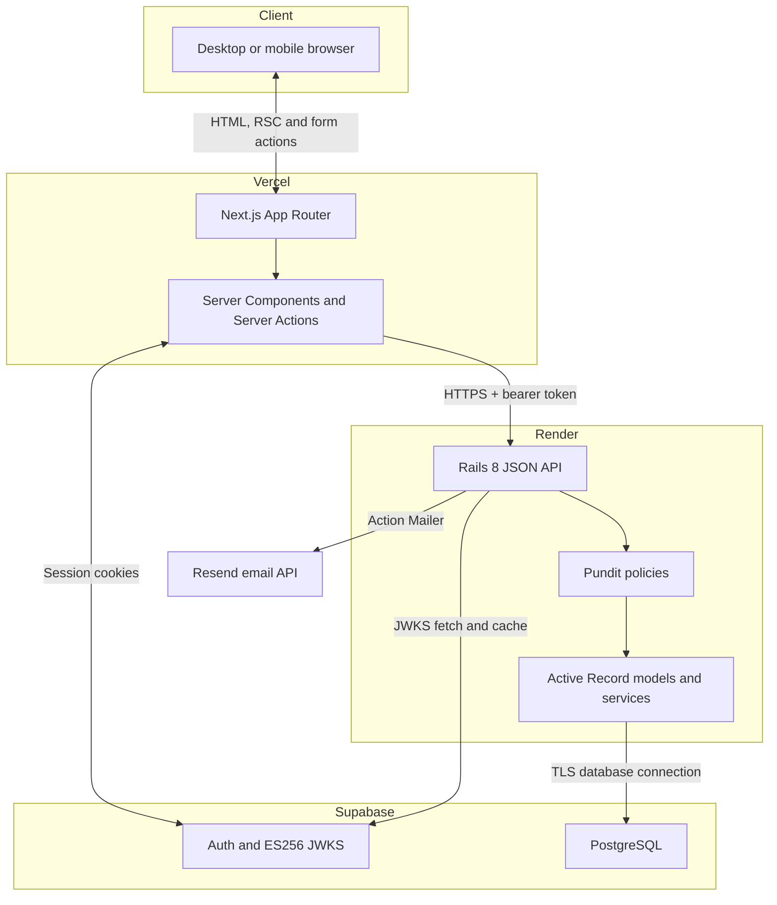
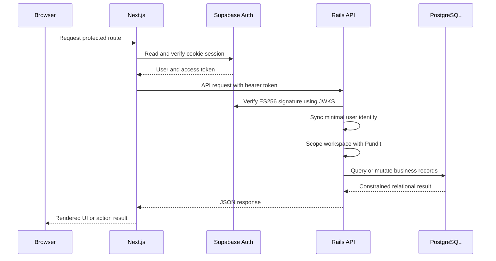
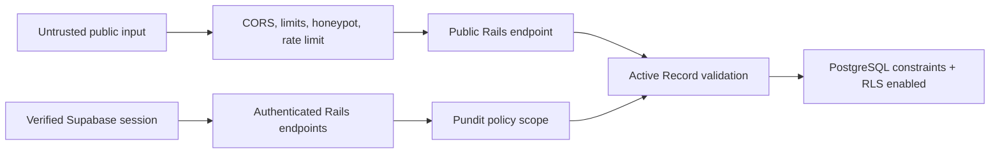
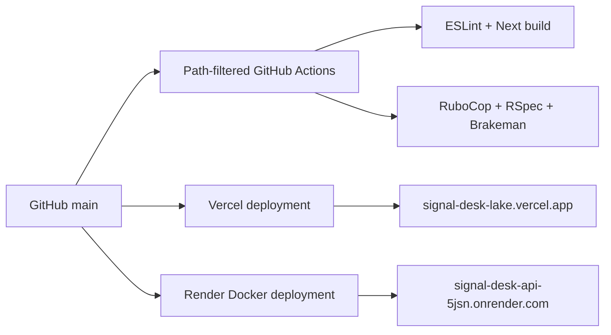

# Architecture

SignalDesk separates rendering, identity and domain ownership while keeping the
number of external services small. The central rule is simple: Next.js owns the
experience, Rails owns business behavior, and Supabase owns identity plus the
PostgreSQL infrastructure.

## System topology

## Authenticated request

Supabase credentials and refresh tokens never enter Rails. Rails receives only
the access token required to establish identity. Conversely, the Supabase
browser client never receives policies that expose SignalDesk business tables.

## Domain ownership

Rails owns these relational boundaries:

- `User` mirrors only the stable Supabase subject, email and display name.
- `Workspace` is the tenant boundary.
- `Membership` joins users to a workspace with owner, admin or member roles.
- `Feedback`, presented as a Signal, belongs to exactly one workspace.
- `Customer`, `Tag`, `Comment` and `ActivityEvent` are validated against the same
  workspace as their parent Signal.
- `WorkspaceInvitation` stores a token digest, role, expiry, inviter and
  acceptance state.

Application services group writes that must succeed atomically. Creating a
Signal also creates its audit event; commenting and state changes follow the
same transaction rule.

## Trust boundaries

The public form can create a new Signal but cannot list, read or update any
workspace resource. Authenticated routes first scope a workspace from the
current user rather than accepting tenant identity on trust from the client.

## Deployment

Vercel uses `apps/web` as its Root Directory, so the monorepo does not publish
Rails as a frontend artifact. Render independently uses `apps/api` as its root
and builds the committed Dockerfile. Each provider reports deployment state for
the same Git commit.

## Local parity

Local development keeps the same ownership boundaries:

- Next.js runs on port `3000`.
- Rails runs on port `3001`.
- the Supabase CLI runs Auth and PostgreSQL locally;
- `pnpm demo:seed` provisions a local identity through the Supabase admin API,
  then calls a Rails service to build the domain dataset.

The E2E suite uses the same provisioning route and deletes its temporary user
and records after each complete browser journey.
